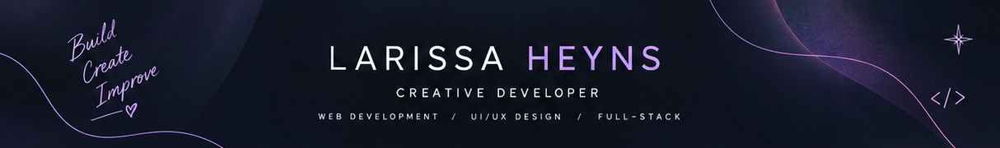

👋 Hi, I'm Larissa Heyns

  

  <strong>Developer | Web Development | Creative Problem-Solving</strong>
   
  Building thoughtful digital experiences through code and design.

  <a href="https://github.com/larissaheyns">GitHub</a> ·
  <a href="https://github.com/larissaheyns?tab=repositories">Projects</a>

I'm a developer who enjoys building interactive web applications and exploring how thoughtful visual design can improve digital experiences.

Through my development projects, I've gained practical experience designing websites, working with layouts and visual consistency, and considering how users interact with digital interfaces. I'm interested in combining these design insights with my technical skills to build functional, engaging applications.

## ✦ About Me

- 💻 Interested in web development and full-stack applications.
- 🎨 Enjoy creating visually engaging websites and interfaces.
- 🛠️ Building practical applications through hands-on development projects.
- 🌱 Continuously learning new technologies and improving my code.
- 📍 Based in South Africa.

## 🎯 My Approach

I believe a good application should work well and feel intuitive to use. My projects give me opportunities to strengthen my programming skills while applying what I've learned about website design, visual hierarchy, and user interaction.

I'm focused on becoming a stronger developer, building meaningful projects, and creating digital experiences that combine functionality with thoughtful design.

## 🧰 Technologies & Tools

**Languages and Web Technologies**

**Frameworks and Backend**

**Database and Development Tools**

---

## 🚀 Featured Projects

### 🎵 Music Application — API Integration

An API-driven music application exploring music data and interactive frontend experiences. This project is also an opportunity to revisit an earlier implementation, restore its API integration, and improve the user interface.

**Focus:** React, API integration, frontend development.

[View Repository →](https://github.com/larissaheyns/DV200_Larissa_Heyns)

### 🎓 Student Slide — Student Marketplace

A student marketplace designed to let students buy, sell, and trade unwanted items. The application explores authentication, role-based access, listing management, and communication between users.

**Key features**
- Student and administrator roles.
- Listing creation and approval workflows.
- Marketplace browsing and item management.
- Buying, trading, and seller communication.

**Tech stack:** MongoDB · Express.js · React · Node.js

[View Repository →](https://github.com/gabri3llp/dv200_keyboardlickers_studentslide)

### 🌌 The Canopy — Dreams & Consciousness

An interactive application concept inspired by dreams and the collective subconscious. The project combines a distinctive visual identity with a connected experience built around user-created dream entries.

**Focus:** React, CRUD functionality, interface design, and database-driven application development.

[View Repository →](https://github.com/larissaheyns/The-Canopy)

### 💛 Sunfield Fortuna — Charity Website UX/UI

A website redesign project for a charity supporting people with disabilities. The design work focuses on creating a more welcoming, accessible, and visually engaging experience while maintaining the site's existing structure and improving its visual consistency.

**Focus:** UI/UX design, Figma, visual hierarchy, accessibility considerations, and responsive design planning.

[View Repository →](https://github.com/larissaheyns/Sunfield-Fortuna-Larissa-Heyns-251048)

---

## 🎯 My Development Philosophy

I believe great digital experiences come from combining thoughtful design with functional, maintainable code.

Every project is an opportunity to learn something new, approach problems differently, and turn an idea into something tangible. I'm focused on developing my technical skills while building projects that demonstrate creativity, problem-solving, and attention to detail.

---

## 🤝 Let's Connect

I'm always interested in learning from other developers, exploring new technologies, and collaborating on creative projects.

- **GitHub:** [@larissaheyns](https://github.com/larissaheyns)
- **Location:** South Africa

---

  <i>Building, learning, and creating — one project at a time.</i>

